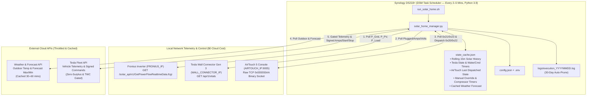
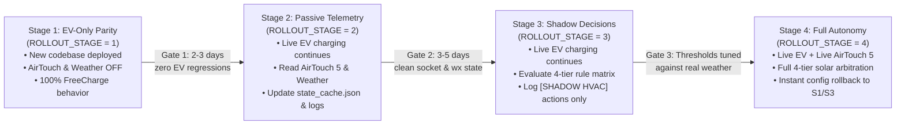

# `AIRTOUCH_AUTOMATION_PLAN.md`
## Unified Home Energy, Climate (AirTouch 5) & EV (Tesla) Solar Orchestrator for Synology DS218+

- **Base Architecture:** Built directly on the proven `FreeCharge` (`tesla_solar_manager.py`) stateless Synology DSM Task Scheduler pattern (Python 3.9 venv, `config.json`, `.env`, `state_cache.json`, `astral` daylight windows, rolling median history, daily auto-pruned logs).
- **Local LAN Targets:**
  - **Fronius Primo 5kW Inverter:** `FRONIUS_IP` (`GetPowerFlowRealtimeData.fcgi`)
  - **AirTouch 5 Console:** `AIRTOUCH_IP:9005` (Raw TCP binary protocol)
  - **Tesla Wall Connector Gen 3:** `WALL_CONNECTOR_IP` (`/api/1/vitals`)
- **External APIs:**
  - **Tesla Fleet API:** Signed protobuf vehicle commands (`charge_start`, `charge_stop`, `set_charging_amps`) & throttled telemetry
  - **BOM / Weather Forecast API:** Local outdoor ambient temperature & daily max/min forecast
- **Host Platform:** Synology DS218+ (2 GB RAM, DSM 7.x, Python 3.9, running alongside Plex Media Server). Because the unified script runs via Task Scheduler every 2–5 minutes and exits cleanly, its idle RAM footprint between ticks is **0 MB** and active execution uses **~22 MB** for `< 2 seconds`.

---

## 1. Unified System Architecture & Priority Waterfall

### 1.1 Why One Process Replaces Two
Running `FreeCharge` and `AirTouchAutomater` as separate processes against a single 5 kW Fronius inverter creates a classic two-controller feedback race:
- If `FreeCharge` ramps the Tesla to `14 A` (`3,360 W`), net grid export (`P_Grid`) drops near `0 W`, blinding a separate HVAC script to the true solar surplus.
- Conversely, if the HVAC script turns on the AC (`~2,200 W`) while the Tesla is pulling `3,360 W`, the house immediately imports `> 2 kW` from the grid until the next EV polling cycle.

By combining both into a **single periodic orchestrator (`solar_home_manager.py`)**, every run collects all telemetry once, calculates the **Total Discretionary Solar Pool**, allocates watts top-down through your 4 priority tiers, and dispatches coordinated adjustments to both the Tesla and the AirTouch 5 in a single atomic pass.

### 1.2 Architectural Flow Diagram



### 1.3 The 4-Tier Priority Waterfall & Solar Pool Allocation

The orchestrator evaluates energy and climate needs in strict priority order:
1. **Priority 1:** Immediate needs for home climate (comfort bounds & differential night purge)
2. **Priority 2:** Charging the car when it is below 90% charged (`SoC < 90%`)
3. **Priority 3:** Pre-cooling / pre-heating the home using excess solar in preparation for hot/cold weather
4. **Priority 4:** Charging the car from 90% to 100% (`90% <= SoC <= 100%`)

```mermaid
flowchart TD
    START["Calculate Total Discretionary Solar Pool (W)<br/>P_pool = Net_Export_W + Active_EV_Draw_W + Active_Tier3_HVAC_Draw_W - Buffer_W<br/>Compute 15-Min Rolling Median: P_median"] --> T1

    subgraph T1_BOX["PRIORITY 1: Immediate Home Climate Needs (Comfort & Night Purge)"]
        T1{"Are occupied zones outside<br/>Immediate Comfort Bounds?<br/>(e.g. >24.5°C Summer / <18.5°C Winter)<br/>OR Night Purge eligible?"}
        T1 -->|Yes| T1_ACT["• Activate AirTouch 5 (COOL / HEAT / FAN Night Purge)<br/>• Balance dampers toward occupied rooms<br/>• Treat HVAC draw as mandatory base load<br/>  (Deduct ~2,000W from P_median if newly starting AC)"]
        T1 -->|No| T1_PASS["• Immediate comfort satisfied<br/>• Full P_median available for discretionary tiers"]
    end

    T1_ACT --> T2
    T1_PASS --> T2

    subgraph T2_BOX["PRIORITY 2: Tesla Charging Below 90% SoC"]
        T2{"Vehicle Connected on TWC,<br/>At Home, Daylight,<br/>and SoC < 90%?"}
        T2 -->|Yes| T2_ACT["• Allocate P_median to Tesla first (min 1,200W / 5A..32A)<br/>• If Tier 3 Pre-Cool/Heat was running and starving EV,<br/>  exit Tier 3 (once min compressor run-time met)<br/>• P_remaining = P_median - Allocated_EV_Watts"]
        T2 -->|No| T2_PASS["• P_remaining = P_median"]
    end

    T2_ACT --> T3
    T2_PASS --> T3

    subgraph T3_BOX["PRIORITY 3: Home Solar Pre-Cool / Pre-Heat (Thermal Banking)"]
        T3{"Forecast Hot (>=30°C) or Cold (<=16°C)<br/>AND Priority Zones not yet at Bank Temp<br/>AND P_remaining >= HVAC_PRECOOL_WATTS (2,000W)?"}
        T3 -->|Yes| T3_ACT["• Activate AirTouch 5 Solar Soak (Pre-Cool 21.5°C / Pre-Heat 22.5°C)<br/>• Open priority living/master dampers, throttle unused rooms<br/>• P_remaining = P_remaining - Est_HVAC_Watts (2,000W)"]
        T3 -->|No| T3_PASS["• Keep HVAC idle (or exit Tier 3 if P_remaining deficit > 10m)<br/>• P_remaining unchanged"]
    end

    T3_ACT --> T4
    T3_PASS --> T4

    subgraph T4_BOX["PRIORITY 4: Tesla Top-Off Charging (90% to 100% SoC)"]
        T4{"Vehicle Connected, At Home,<br/>90% <= SoC < Charge_Limit_SoC,<br/>and P_remaining >= 1,200W (5A)?"}
        T4 -->|Yes| T4_ACT["• Allocate residual P_remaining to Tesla (5A..32A)"]
        T4 -->|No| T4_PASS["• Stop/Hold EV charge if SoC >= 90% and P_remaining < 1,200W"]
    end

    T4_ACT --> DISPATCH["Coordinated Command Dispatch<br/>1. Step down/stop lower-priority load FIRST (e.g. reduce EV amps before starting AC)<br/>2. Apply Compressor Short-Cycle & Tesla 10-min Throttle Guards<br/>3. Persist updated state to state_cache.json"]
    T4_PASS --> DISPATCH
```



---

## 2. Mathematical Model: True Discretionary Solar Pool

When both the Tesla Wall Connector and the AirTouch 5 ducted AC are managed by one script, the Fronius Smart Meter (`P_Grid`) reports the *net* export after both loads are already subtracted. To prevent feedback oscillation when either or both are running:

1. **Raw Net Export ($P_{\text{export}}$):**
   $$P_{\text{export}} = \begin{cases} P_{\text{grid}} & \text{if } \text{FRONIUS\_EXPORT\_IS\_POSITIVE is True} \\ -P_{\text{grid}} & \text{if } \text{FRONIUS\_EXPORT\_IS\_POSITIVE is False} \end{cases}$$

2. **Active EV Charging Draw ($P_{\text{ev\_draw}}$):**
   Read directly from the local Tesla Wall Connector Gen 3 vitals (`WALL_CONNECTOR_IP/api/1/vitals`) when `contactor_closed == True`:
   $$P_{\text{ev\_draw}} = I_{\text{vehicle\_current\_a}} \times V_{\text{grid\_v}}$$
   *(Falls back to `cache["amps"] * config["VOLTAGE"]` if Wall Connector vitals are mocked or temporarily unreachable).*

3. **Active Discretionary HVAC Draw ($P_{\text{hvac\_discretionary}}$):**
   - If the AirTouch 5 is currently running in **Tier 3 (`SOLAR_PRECOOL` or `SOLAR_PREHEAT`)**, its power is *discretionary* solar consumption and must be added back to the pool so the orchestrator knows total available solar:
     $$P_{\text{hvac\_discretionary}} = \text{HVAC\_ESTIMATED\_WATTS} \quad (\text{default } 2000\text{ W})$$
   - If the AirTouch 5 is running in **Tier 1 (`IMMEDIATE_COMFORT`)** or **`MANUAL_OVERRIDE`**, its consumption is **mandatory household load**, so $P_{\text{hvac\_discretionary}} = 0\text{ W}$ (already reflected in $P_{\text{grid}}$).

4. **Total Discretionary Solar Pool ($P_{\text{pool}}$):**
   $$P_{\text{pool}} = P_{\text{export}} + P_{\text{ev\_draw}} + P_{\text{hvac\_discretionary}} - P_{\text{buffer}}$$
   This $P_{\text{pool}}$ value is appended to `cache["solar_history"]` (15-minute window), and its **median** ($P_{\text{median}}$) drives Tiers 2, 3, and 4.

5. **Same-Tick Hand-Off Adjustment:**
   - If **Tier 1 (`IMMEDIATE_COMFORT`)** transitions the AC from `OFF` $\rightarrow$ `ON` during the current tick, the AC compressor has not yet ramped up on the Fronius meter. The orchestrator immediately subtracts `HVAC_ESTIMATED_WATTS` (`2,000 W`) from $P_{\text{median}}$ in the same tick so the Tesla charger steps down *before* the compressor ramps up.
   - Similarly, if **Tier 2 (`EV < 90%`)** preempts **Tier 3 (`SOLAR_PRECOOL`)**, or if **Tier 3 (`SOLAR_PRECOOL`)** preempts **Tier 4 (`EV 90–100%`)**, the lower-priority device is commanded down/off first.

---

## 3. Phase 1: AirTouch 5 Protocol Handshake & Socket Verification

### 3.1 AirTouch 5 Binary Frame Specification (`AIRTOUCH_IP:9005`)

> **Critical Protocol Distinction (AirTouch 4 vs. AirTouch 5):**
> Unlike AirTouch 4 (which uses a 2-byte `0x55 0x55` sync header), **AirTouch 5 uses a 4-byte magic sync header (`0x55 0x55 0x55 0xAA`)** on TCP port `9005` and enforces **byte-stuffing** (`0x55 0x55 0x55 0x00`) inside the frame body so the magic header never occurs accidentally in payload data.

#### Outer Frame Layout (Big-Endian Network Byte Order)

```text
+-------------------+-------------------+------------+------------+-------------------+-------------------------+-------------------+
|   Header Magic    |      Address      | Message ID |  Msg Type  |    Data Length    |   Payload (Sub-frame)   |  CRC-16 (MODBUS)  |
|      4 Bytes      |      2 Bytes      |   1 Byte   |   1 Byte   |  2 Bytes (uint16) |     N Bytes (Variable)  |  2 Bytes (uint16) |
+-------------------+-------------------+------------+------------+-------------------+-------------------------+-------------------+
| 0x55 0x55 0x55 AA | 0x80 0xB0 (C->AT) | 0x01..0xFF | 0xC0 (Ctl) |  Length of Payload | Subheader + Normal Data | Big-Endian CRC16  |
|                   | 0xB0 0x80 (AT->C) |            | 0x1F (Ext) |  (Before Stuffing)| + Repeat Data Blocks    | over Bytes [4..End]|
+-------------------+-------------------+------------+------------+-------------------+-------------------------+-------------------+
```

#### Addressing & Message Types
| Direction | Message Category | Address Bytes | `Msg Type` | Subtype Location |
| :--- | :--- | :--- | :--- | :--- |
| Client $\rightarrow$ AirTouch 5 | Control / Status Request | `0x80 0xB0` | `0xC0` | Payload Byte 0 (`0x20`–`0x23`) |
| AirTouch 5 $\rightarrow$ Client | Control / Status Response (or Push) | `0xB0 0x80` | `0xC0` | Payload Byte 0 (`0x20`–`0x23`) |
| Client $\rightarrow$ AirTouch 5 | Extended Query (Zone Names, Capabilities) | `0x90 0xB0` | `0x1F` | Payload Bytes 0–1 (`0xFF 0x11`–`0xFF 0x30`) |
| AirTouch 5 $\rightarrow$ Client | Extended Response | `0xB0 0x90` | `0x1F` | Payload Bytes 0–1 (`0xFF 0x11`–`0xFF 0x30`) |

#### Control/Status Payload Sub-Header (`Msg Type == 0xC0`, 8 Bytes)
```text
+---------------+---------------+-----------------------+-----------------------+-----------------------+
| Subtype (1B)  | Reserved (1B) | Normal Data Len (2B)  | Repeat Data Len (2B)  |   Repeat Count (2B)   |
+---------------+---------------+-----------------------+-----------------------+-----------------------+
| 0x20 Zone Ctl |     0x00      | uint16 BE (usually 0) | uint16 BE (0, 4, 8,10)| uint16 BE (# of items)|
| 0x21 Zone Sts |               |                       |                       |                       |
| 0x22 AC Ctl   |               |                       |                       |                       |
| 0x23 AC Sts   |               |                       |                       |                       |
+---------------+---------------+-----------------------+-----------------------+-----------------------+
```

#### Redundant Byte Stuffing & CRC-16 Rules
- **Byte Stuffing:** Any `0x55 0x55 0x55` sequence after the 4-byte header has `0x00` inserted after it (`0x55 0x55 0x55 0x00`) on transmit, and stripped before length/CRC evaluation on receive.
- **CRC-16/MODBUS:** Polynomial `0xA001` (init `0xFFFF`), computed over all unstuffed bytes from **Address (Offset 4)** through the **end of Payload**, appended in Big-Endian (`struct.pack(">H", crc)`).

#### Response Payload Schemas
- **Zone Status Record (`0x21`, 8 bytes per zone):**
  - `Byte 0`: `(Power << 6) | (ZoneIndex & 0x3F)` where Power: `0=Off`, `1=On`, `3=Turbo`.
  - `Byte 1`: `(ControlMode << 7) | (DamperPct & 0x7F)` where ControlMode: `0=Airflow %`, `1=Temperature`.
  - `Byte 2`: `Setpoint` $\rightarrow$ `Temp_C = (Byte2 + 100) / 10.0` (`0xFF` = No Setpoint / Percentage Mode).
  - `Byte 3`: `Bit 7 (0x80)` = `1` if ITC temperature sensor is paired, `0` if no sensor.
  - `Bytes 4..5` (`uint16 BE`): `SensorTemp` $\rightarrow$ `raw = val & 0x07FF`; if `raw <= 2000`, `Temp_C = (raw - 500) / 10.0` (else `N/A`).
  - `Byte 6`: `Flags` $\rightarrow$ `Bit 0 (0x01)` = ITC Low Battery, `Bit 1 (0x02)` = Zone Spill Active.
  - `Byte 7`: `0x00` (Reserved).

- **AC Status Record (`0x23`, 10 bytes per AC unit):**
  - `Byte 0`: `Bits 7..4` = Power (`0=Off`, `1=On`, `2=AwayOff`, `3=AwayOn`, `5=Sleep`); `Bits 3..0` = AC Index.
  - `Byte 1`: `Bits 7..4` = Mode (`0=Auto`, `1=Heat`, `2=Dry`, `3=Fan`, `4=Cool`, `8=AutoHeat`, `9=AutoCool`); `Bits 3..0` = Fan Speed (`0=Auto`, `1=Quiet`, `2=Low`, `3=Med`, `4=High`, `5=Powerful`, `7=Turbo`, `Bit 3` = IntelligentAuto).
  - `Byte 2`: `Setpoint` $\rightarrow$ `Temp_C = (Byte2 + 100) / 10.0`.
  - `Byte 3`: `Flags` $\rightarrow$ `Bit 0` = Timer, `Bit 1` = Spill, `Bit 2` = Bypass, `Bit 3` = Turbo.
  - `Bytes 4..5` (`uint16 BE`): `ReturnAirTemp` $\rightarrow$ `((val & 0x07FF) - 500) / 10.0`.
  - `Bytes 6..7` (`uint16 BE`): `ErrorCode` (`0x0000` = Normal).
  - `Bytes 8..9` (`uint16 BE`): Reserved (`0x8000`).

---

### 3.2 Standalone Verification Script (`verify_socket.py`)

This Python 3.9-compatible script requires **zero third-party pip packages** and verifies bidirectional communication with `AIRTOUCH_IP:9005`.

```python
#!/usr/bin/env python3
"""
Phase 1: AirTouch 5 Raw Socket & Binary Protocol Verification Script
Target: AIRTOUCH_IP:9005 (Python 3.9+ standard library only)
"""
import argparse
import json
import os
import socket
import struct
import time
from typing import Dict, List, Optional, Tuple

MAGIC_HEADER = b"\x55\x55\x55\xaa"
STUFF_FIND = b"\x55\x55\x55"
STUFF_REPLACE = b"\x55\x55\x55\x00"

AC_POWER_MAP = {0: "OFF", 1: "ON", 2: "AWAY_OFF", 3: "AWAY_ON", 5: "SLEEP"}
AC_MODE_MAP = {
    0: "AUTO", 1: "HEAT", 2: "DRY", 3: "FAN",
    4: "COOL", 8: "AUTO_HEAT", 9: "AUTO_COOL",
}
FAN_SPEED_MAP = {
    0: "AUTO", 1: "QUIET", 2: "LOW", 3: "MEDIUM",
    4: "HIGH", 5: "POWERFUL", 7: "TURBO",
}
ZONE_POWER_MAP = {0: "OFF", 1: "ON", 3: "TURBO"}


def crc16_modbus(data: bytes) -> int:
    """Compute CRC-16/MODBUS over unstuffed frame body (Address..Data)."""
    crc = 0xFFFF
    for byte in data:
        crc ^= byte
        for _ in range(8):
            if crc & 0x0001:
                crc = (crc >> 1) ^ 0xA001
            else:
                crc >>= 1
    return crc & 0xFFFF


def pack_frame(address: int, msg_id: int, msg_type: int, payload: bytes) -> bytes:
    """Assemble an AirTouch 5 frame with CRC-16 and 0x55555500 byte stuffing."""
    body = struct.pack(">HBBH", address, msg_id & 0xFF, msg_type, len(payload)) + payload
    crc = crc16_modbus(body)
    raw_after_magic = body + struct.pack(">H", crc)
    stuffed = raw_after_magic.replace(STUFF_FIND, STUFF_REPLACE)
    return MAGIC_HEADER + stuffed


def read_next_frame(sock: socket.socket, rx_buf: bytearray) -> Tuple[int, int, int, bytes]:
    """Read from socket buffer until a valid, CRC-verified frame is decoded."""
    while True:
        idx = rx_buf.find(MAGIC_HEADER)
        if idx != -1:
            if idx > 0:
                del rx_buf[:idx]
            unstuffed = bytes(rx_buf[4:]).replace(STUFF_REPLACE, STUFF_FIND)
            if len(unstuffed) >= 6:
                address, msg_id, msg_type, data_len = struct.unpack(">HBBH", unstuffed[:6])
                total_unstuffed_len = 6 + data_len + 2
                if len(unstuffed) >= total_unstuffed_len:
                    frame_body = unstuffed[: 6 + data_len]
                    expected_crc = struct.unpack(">H", unstuffed[6 + data_len : total_unstuffed_len])[0]
                    wire_tail = (frame_body + struct.pack(">H", expected_crc)).replace(
                        STUFF_FIND, STUFF_REPLACE
                    )
                    del rx_buf[: 4 + len(wire_tail)]

                    calc_crc = crc16_modbus(frame_body)
                    if calc_crc != expected_crc:
                        raise ValueError(
                            f"CRC mismatch: calculated 0x{calc_crc:04X}, got 0x{expected_crc:04X}"
                        )
                    payload = frame_body[6:]
                    return address, msg_id, msg_type, payload

        chunk = sock.recv(1024)
        if not chunk:
            raise ConnectionError("Socket closed by AirTouch 5 console")
        rx_buf.extend(chunk)


def build_status_req(subtype: int, msg_id: int) -> bytes:
    payload = struct.pack(">BBHHH", subtype, 0x00, 0, 0, 0)
    return pack_frame(0x80B0, msg_id, 0xC0, payload)


def build_zone_names_req(msg_id: int) -> bytes:
    return pack_frame(0x90B0, msg_id, 0x1F, b"\xff\x13")


def parse_ac_status(payload: bytes) -> List[Dict]:
    subtype, _, norm_len, rpt_len, rpt_cnt = struct.unpack(">BBHHH", payload[:8])
    if subtype != 0x23:
        return []
    offset = 8 + norm_len
    acs = []
    for _ in range(rpt_cnt):
        rec = payload[offset : offset + rpt_len]
        offset += rpt_len
        ac_idx = rec[0] & 0x0F
        power_raw = (rec[0] >> 4) & 0x0F
        mode_raw = (rec[1] >> 4) & 0x0F
        fan_raw = rec[1] & 0x07
        intell_auto = bool(rec[1] & 0x08)
        setpoint_c = (rec[2] + 100) / 10.0 if rec[2] < 0xFF else None
        flags = rec[3]
        raw_temp = struct.unpack(">H", rec[4:6])[0] & 0x07FF
        ambient_c = (raw_temp - 500) / 10.0 if raw_temp <= 2000 else None
        err_code = struct.unpack(">H", rec[6:8])[0]
        acs.append({
            "ac_index": ac_idx,
            "power": AC_POWER_MAP.get(power_raw, f"UNKNOWN({power_raw})"),
            "mode": AC_MODE_MAP.get(mode_raw, f"UNKNOWN({mode_raw})"),
            "fan_speed": FAN_SPEED_MAP.get(fan_raw, f"UNKNOWN({fan_raw})"),
            "intelligent_auto": intell_auto,
            "setpoint_c": setpoint_c,
            "return_air_temp_c": ambient_c,
            "spill_active": bool(flags & 0x02),
            "bypass_active": bool(flags & 0x04),
            "turbo_active": bool(flags & 0x08),
            "error_code": err_code,
        })
    return acs


def parse_zone_status(payload: bytes, zone_names: Dict[int, str]) -> List[Dict]:
    subtype, _, norm_len, rpt_len, rpt_cnt = struct.unpack(">BBHHH", payload[:8])
    if subtype != 0x21:
        return []
    offset = 8 + norm_len
    zones = []
    for _ in range(rpt_cnt):
        rec = payload[offset : offset + rpt_len]
        offset += rpt_len
        zone_idx = rec[0] & 0x3F
        power_raw = (rec[0] >> 6) & 0x03
        is_temp_control = bool(rec[1] & 0x80)
        damper_pct = rec[1] & 0x7F
        setpoint_c = (rec[2] + 100) / 10.0 if (is_temp_control and rec[2] < 0xFF) else None
        has_sensor = bool(rec[3] & 0x80)
        raw_sensor = struct.unpack(">H", rec[4:6])[0] & 0x07FF
        sensor_c = (raw_sensor - 500) / 10.0 if (has_sensor and raw_sensor <= 2000) else None
        flags = rec[6]
        zones.append({
            "zone_index": zone_idx,
            "name": zone_names.get(zone_idx, f"Zone_{zone_idx}"),
            "power": ZONE_POWER_MAP.get(power_raw, f"UNKNOWN({power_raw})"),
            "control_mode": "TEMPERATURE" if is_temp_control else "DAMPER_PCT",
            "damper_open_pct": damper_pct,
            "setpoint_c": setpoint_c,
            "has_itc_sensor": has_sensor,
            "temperature_c": sensor_c,
            "battery_low": bool(flags & 0x01),
            "spill_active": bool(flags & 0x02),
        })
    return zones


def parse_zone_names(payload: bytes) -> Dict[int, str]:
    if len(payload) < 2 or payload[:2] != b"\xff\x13":
        return {}
    names: Dict[int, str] = {}
    i = 2
    while i + 2 <= len(payload):
        z_idx = payload[i]
        name_len = payload[i + 1]
        raw_name = payload[i + 2 : i + 2 + name_len]
        names[z_idx] = raw_name.decode("utf-8", errors="ignore").strip("\x00")
        i += 2 + name_len
    return names


def verify_airtouch(host: str, port: int, timeout: float = 5.0) -> None:
    rx_buf = bytearray()
    zone_names: Dict[int, str] = {}
    ac_list: Optional[List[Dict]] = None
    zone_list: Optional[List[Dict]] = None

    with socket.create_connection((host, port), timeout=timeout) as sock:
        sock.sendall(build_zone_names_req(msg_id=1))
        sock.sendall(build_status_req(subtype=0x23, msg_id=2))
        sock.sendall(build_status_req(subtype=0x21, msg_id=3))

        deadline = time.monotonic() + timeout
        while (ac_list is None or zone_list is None) and time.monotonic() < deadline:
            addr, msg_id, msg_type, payload = read_next_frame(sock, rx_buf)
            if msg_type == 0x1F and payload[:2] == b"\xff\x13":
                zone_names = parse_zone_names(payload)
            elif msg_type == 0xC0 and len(payload) >= 8:
                subtype = payload[0]
                if subtype == 0x23:
                    ac_list = parse_ac_status(payload)
                elif subtype == 0x21:
                    zone_list = parse_zone_status(payload, zone_names)

    if zone_list and zone_names:
        for z in zone_list:
            z["name"] = zone_names.get(z["zone_index"], z["name"])

    report = {
        "console": f"{host}:{port}",
        "timestamp": time.strftime("%Y-%m-%dT%H:%M:%S%z"),
        "ac_units": ac_list or [],
        "zones": zone_list or [],
    }
    print(json.dumps(report, indent=2))


if __name__ == "__main__":
    parser = argparse.ArgumentParser(description="Verify AirTouch 5 TCP Socket")
    # Console address comes from .env -> AIRTOUCH_IP (never hardcoded here).
    parser.add_argument("--host", default=os.getenv("AIRTOUCH_IP", ""), help="AirTouch 5 Console IP")
    parser.add_argument("--port", type=int, default=9005, help="AirTouch 5 TCP Port")
    args = parser.parse_args()
    verify_airtouch(args.host, args.port)
```

---

## 4. Phase 2: AirTouch 5 Command Formulation & Manual Override Protection

### 4.1 Safe Command Formulation (`0x20` Zone Control & `0x22` AC Control)
- **Zone Control (`Msg Type = 0xC0`, `Subtype = 0x20`, 4 Bytes per Zone):**
  - `Byte 0`: `zone_index & 0x3F`
  - `Byte 1`:
    - `Bits 7..5` (Value Op): `0b000` = Keep, `0b100` (`0x80`) = Set Damper %, `0b101` (`0xA0`) = Set Setpoint °C.
    - `Bits 4..3` (Control Mode): `0b00` = Keep, `0b10` (`0x10`) = Force Damper % Mode, `0b11` (`0x18`) = Force Temperature Mode (only if `has_itc_sensor == True`).
    - `Bits 2..0` (Power): `0b000` = Keep, `0b010` (`0x02`) = Off, `0b011` (`0x03`) = On, `0b101` (`0x05`) = Turbo.
  - `Byte 2`: Quantized 5% damper value (`0..100`), encoded setpoint (`int(round(temp_c * 10)) - 100`), or `0xFF` if unchanged.
  - `Byte 3`: `0x00`.

- **AC Control (`Msg Type = 0xC0`, `Subtype = 0x22`, 4 Bytes per AC Unit):**
  - `Byte 0`: `(PowerCmd << 4) | (ac_index & 0x0F)` where `PowerCmd`: `0=Keep`, `2=Off`, `3=On`.
  - `Byte 1`: `(ModeCmd << 4) | FanSpeedCmd` where `ModeCmd`: `0=Auto`, `1=Heat`, `2=Dry`, `3=Fan`, `4=Cool`, `0xF=Keep`; `FanSpeedCmd`: `0=Auto`, `1=Quiet`, `2=Low`, `3=Med`, `4=High`, `0xF=Keep`.
  - `Byte 2`: `0x40` to set new setpoint, `0x00` to keep current setpoint.
  - `Byte 3`: `int(round(temp_c * 10)) - 100` if `Byte 2 == 0x40`, else `0xFF`.

### 4.2 Stateless Periodic Socket Pattern (Matching `FreeCharge`)
Instead of holding a permanent socket open 24/7, each Task Scheduler invocation (`every 2–5 minutes`) opens a TCP socket (`timeout=5.0s`) to `AIRTOUCH_IP:9005`:
1. **Read Current State:** Polls `0x23` (AC Status) and `0x21` (Zone Status).
2. **Detect Manual Human Override:**
   Compares live AirTouch state against `cache["airtouch_last_dispatched"]`:
   - If the human user changed AC Power, Mode, Setpoint, or turned a Zone On/Off via the wall tablet or smartphone app since the last run, the orchestrator sets `cache["airtouch_manual_override_until"] = now + 120 mins`.
   - While in `MANUAL_OVERRIDE`, the script **never** overwrites AirTouch settings, and treats active AC operation as mandatory household load (protecting comfort while still scaling Tesla solar charging around the user's manual AC usage).
3. **Dispatch Delta Commands Only:**
   If not in manual override and the decision engine requires an AC or Zone change, sends a single batched `0x22` (AC Control) and/or `0x20` (Zone Control) frame, waits `0.5s` for the console's `0x21`/`0x23` acknowledgement frame, updates `cache["airtouch_last_dispatched"]`, and closes the socket cleanly.

### 4.3 Compressor Short-Cycle & Damper Protection
- **Minimum Compressor Run/Off Time:** Stored in `cache["airtouch_last_power_change_time"]`. The AC cannot be toggled `ON -> OFF` until `HVAC_MIN_ON_MINUTES` (`15 mins`) has elapsed, nor `OFF -> ON` until `HVAC_MIN_OFF_MINUTES` (`6 mins`) has elapsed.
- **Spill & Duct Pressure Guard:** Whenever `AC Power == ON`, total open damper percentage across active zones must remain $\ge 120\%$ (and at least 1 primary zone `ON`).
- **5% Quantization & 10% Deadband:** Damper adjustments are quantized to `5%` increments and only sent when the target differs from actual by $\ge 10\%$, preventing stepper motor wear.

---

## 5. Phase 3: Unified Telemetry Ingestion & Caching

All telemetry is gathered in a single pass at the start of `run_orchestrator_loop()` with strict fault isolation (a failure in one sensor never crashes the others):

| Source | Function | Frequency / Caching | Failure Fallback |
| :--- | :--- | :--- | :--- |
| **Fronius (`FRONIUS_IP`)** | `get_fronius_telemetry(config)` | Every run (`2–5m`) | Abort discretionary changes for this tick; keep existing state. |
| **Wall Connector (`WALL_CONNECTOR_IP`)** | `get_wall_connector_vitals(config)` | Every run (`2–5m`) | If `vehicle_connected == False`, skip all Tesla Cloud API calls ($0 cost). |
| **AirTouch 5 (`AIRTOUCH_IP:9005`)** | `get_airtouch_state(config)` | Every run (`2–5m`) | Log socket warning; still run Tesla solar tracking using `P_Grid`. |
| **Weather / BOM Forecast** | `get_weather_state(config, cache)` | Cached in `state_cache.json`, refreshed every `30 mins` | Fall back to cached forecast; if $>12\text{h}$ stale, disable Tier 3 pre-cool/heat. |
| **Tesla Fleet API** | `get_tesla_vehicle_data(config)` | Gated by TWC & refreshed every `15 mins` (`60 mins` when full) | Use cached `vehicle_state` (`battery_level`, `charge_limit_soc`). |

---

## 6. Phase 4: The 4-Tier Decision Engine Specification

### 6.1 Configuration Schema (`config.json`)

```json
{
  "FRONIUS_EXPORT_IS_POSITIVE": false,
  "TIMEZONE": "Australia/Sydney",
  "CITY_NAME": "Sydney",
  "VOLTAGE": 240,
  "MIN_AMPS": 5,
  "MAX_AMPS": 32,
  "BUFFER_WATTS": 150,
  "EV_PRIORITY_SOC_THRESHOLD": 90,
  "LOCATION_TOLERANCE": 0.001,
  "HISTORY_WINDOW_MINUTES": 15,
  "POLLING_INTERVAL_MINUTES": 5,
  "THROTTLE_INTERVAL_MINUTES": 10,
  "TELEMETRY_REFRESH_MINUTES": 15,
  "WAKE_COOLDOWN_MINUTES": 60,
  "TESLA_WALL_CONNECTOR_IP": "WALL_CONNECTOR_IP",
  "AIRTOUCH_IP": "AIRTOUCH_IP",
  "AIRTOUCH_PORT": 9005,
  "HVAC_ESTIMATED_WATTS": 2000,
  "HVAC_MIN_ON_MINUTES": 15,
  "HVAC_MIN_OFF_MINUTES": 6,
  "HVAC_MANUAL_OVERRIDE_MINUTES": 120,
  "COMFORT_COOL_TRIGGER_C": 24.5,
  "COMFORT_COOL_TARGET_C": 23.0,
  "COMFORT_HEAT_TRIGGER_C": 18.5,
  "COMFORT_HEAT_TARGET_C": 20.5,
  "PRECOOL_FORECAST_MIN_MAX_C": 30.0,
  "PRECOOL_TARGET_C": 21.5,
  "PREHEAT_FORECAST_MAX_C": 16.0,
  "PREHEAT_TARGET_C": 22.5,
  "NIGHT_PURGE_DELTA_C": 2.0,
  "ZONES": {
    "0": {"name": "Living", "priority": 1.0, "occupied_hours": [7, 22], "min_damper": 20},
    "1": {"name": "Master", "priority": 0.9, "occupied_hours": [20, 8], "min_damper": 15},
    "2": {"name": "Office", "priority": 0.8, "occupied_hours": [8, 18], "min_damper": 15},
    "3": {"name": "Guest",  "priority": 0.2, "occupied_hours": [21, 7], "min_damper": 0}
  },
  "MAX_LOG_DAYS": 30,
  "ROLLOUT_STAGE": 1,
  "ENABLE_CLIMATE_TELEMETRY": false,
  "ENABLE_CLIMATE_DECISIONS": false,
  "ENABLE_CLIMATE_CONTROL": false,
  "DRY_RUN_TESLA": false,
  "DRY_RUN_CLIMATE": true
}
```

### 6.2 Step-by-Step Decision Logic (`evaluate_energy_and_climate_plan`)

```python
def evaluate_energy_and_climate_plan(
    now, sunrise, sunset, median_pool_watts,
    airtouch_state, weather_state, ev_state, cache, config
):
    """
    Allocates `median_pool_watts` across the 4 priority tiers:
      Tier 1: Immediate Home Climate Comfort (runs regardless of solar)
      Tier 2: EV Charging when SoC < 90%
      Tier 3: Home Solar Pre-Cooling / Pre-Heating (Thermal Banking)
      Tier 4: EV Charging from 90% to 100% SoC
    Returns: (hvac_plan, ev_plan)
    """
    remaining_solar_w = median_pool_watts
    hvac_est_w = config["HVAC_ESTIMATED_WATTS"]
    ev_priority_soc = config.get("EV_PRIORITY_SOC_THRESHOLD", 90)

    # ------------------------------------------------------------------
    # TIER 1: IMMEDIATE HOME CLIMATE COMFORT (Day or Night)
    # ------------------------------------------------------------------
    immediate_need, hvac_comfort_plan = check_immediate_climate_need(
        now, airtouch_state, weather_state, cache, config
    )
    if immediate_need:
        # If AC is turning ON now (was OFF), deduct its expected draw from the pool
        # so EV charging immediately makes room for the compressor.
        if not airtouch_state.get("ac_on") and hvac_comfort_plan["power"] == "ON":
            if hvac_comfort_plan["mode"] in ("COOL", "HEAT"):
                remaining_solar_w = max(0.0, remaining_solar_w - hvac_est_w)
        hvac_plan = hvac_comfort_plan
        tier3_eligible = False
    else:
        hvac_plan = {"action": "IDLE", "power": "OFF", "reason": "Comfort satisfied"}
        tier3_eligible = True

    # Outside daylight hours: EV solar charging & Tier 3 solar banking are inactive
    if now < sunrise or now > sunset:
        ev_plan = {"charging": False, "amps": config["MIN_AMPS"], "tier": "NIGHT_OFF"}
        return hvac_plan, ev_plan

    # Check if EV is eligible to charge (at home, plugged in, SoC < charge_limit)
    ev_ready = (
        ev_state.get("is_home", False)
        and ev_state.get("is_plugged", False)
        and not ev_state.get("is_full", True)
    )
    ev_soc = ev_state.get("battery_level", 100)

    # ------------------------------------------------------------------
    # TIER 2: EV CHARGING BELOW 90% SoC
    # ------------------------------------------------------------------
    ev_plan = {"charging": False, "amps": config["MIN_AMPS"], "tier": "NONE"}
    if ev_ready and ev_soc < ev_priority_soc:
        can_charge, target_amps = calculate_target_amps(remaining_solar_w, config)
        if can_charge:
            ev_allocated_w = target_amps * config["VOLTAGE"]
            remaining_solar_w = max(0.0, remaining_solar_w - ev_allocated_w)
            ev_plan = {"charging": True, "amps": target_amps, "tier": "TIER2_EV_BELOW_90"}

    # ------------------------------------------------------------------
    # TIER 3: HOME SOLAR PRE-COOLING / PRE-HEATING (Thermal Banking)
    # ------------------------------------------------------------------
    if tier3_eligible:
        should_bank, hvac_bank_plan = check_solar_thermal_banking(
            now, remaining_solar_w, airtouch_state, weather_state, cache, config
        )
        if should_bank:
            remaining_solar_w = max(0.0, remaining_solar_w - hvac_est_w)
            hvac_plan = hvac_bank_plan

    # ------------------------------------------------------------------
    # TIER 4: EV TOP-OFF CHARGING (90% to 100% SoC)
    # ------------------------------------------------------------------
    if ev_ready and ev_soc >= ev_priority_soc:
        can_charge, target_amps = calculate_target_amps(remaining_solar_w, config)
        if can_charge:
            ev_allocated_w = target_amps * config["VOLTAGE"]
            remaining_solar_w = max(0.0, remaining_solar_w - ev_allocated_w)
            ev_plan = {"charging": True, "amps": target_amps, "tier": "TIER4_EV_90_TO_100"}

    return hvac_plan, ev_plan
```

### 6.3 Coordinated Execution Order (Avoiding Grid Import Spikes)
When transitioning power between the Tesla and the AirTouch 5 in the same run:
1. **Load Shed First:** If either device is being turned `OFF` or having its draw reduced (e.g., stepping down Tesla amps from `16 A` $\rightarrow$ `6 A` because Tier 3 Pre-Cooling is starting on a $\ge 90\%$ battery, or turning off Tier 3 Pre-Cooling because Tier 2 EV $<90\%$ just plugged in), execute the **reduction/stop command first**.
2. **Load Ramp Second:** Execute the **start/increase command second**.

---

## 7. Phase 5: Progressive 4-Stage Production Rollout & Verification Plan

Real-world household dynamics, cloud transients, and LAN device quirks differ significantly from unit tests. To guarantee we **never break existing Tesla solar charging (`FreeCharge`)**, the unified codebase is designed around a **4-Stage Feature-Gated Rollout** controlled strictly via `config.json` (zero code changes required to advance or roll back between stages).

### 7.1 Progressive Rollout Architecture



### 7.2 Stage Configuration & Behavior Matrix

| Stage | `ROLLOUT_STAGE` | Tesla Charging | AirTouch 5 & Weather Polling | 4-Tier Climate & Solar Arbitration Engine | AirTouch 5 Command Dispatch (`0x20`/`0x22`) | Primary Objective |
| :--- | :---: | :--- | :--- | :--- | :--- | :--- |
| **Deployment 1: EV-Only Parity** | `1` | **LIVE** (`DRY_RUN_TESLA=false`) | **OFF** (`ENABLE_CLIMATE_TELEMETRY=false`) | **OFF** (`ENABLE_CLIMATE_DECISIONS=false`) | **OFF** (`ENABLE_CLIMATE_CONTROL=false`) | Exercise the unified script, `state_cache.json` schema, and Task Scheduler runner with zero behavioural change from `FreeCharge`. |
| **Deployment 2: Passive Telemetry** | `2` | **LIVE** (`DRY_RUN_TESLA=false`) | **ON (Read-Only)** (`ENABLE_CLIMATE_TELEMETRY=true`) | **OFF** (`ENABLE_CLIMATE_DECISIONS=false`) | **OFF** (`ENABLE_CLIMATE_CONTROL=false`) | Validate live AirTouch 5 TCP socket reads (`AIRTOUCH_IP:9005`), CRC/unstuffing, ITC sensor temps, and BOM weather caching in `state_cache.json` without affecting EV charging. |
| **Deployment 3: Shadow Decisions** | `3` | **LIVE** (`DRY_RUN_TESLA=false`) | **ON (Read-Only)** (`ENABLE_CLIMATE_TELEMETRY=true`) | **SHADOW MODE** (`ENABLE_CLIMATE_DECISIONS=true`) | **DRY-RUN LOG ONLY** (`DRY_RUN_CLIMATE=true`) | Compute and log exact `[SHADOW HVAC]` actions and 4-tier priority hand-offs based on complete live state, verifying thresholds before touching the AC. |
| **Deployment 4: Full Autonomy** | `4` | **LIVE** (`DRY_RUN_TESLA=false`) | **ON** (`ENABLE_CLIMATE_TELEMETRY=true`) | **ACTIVE** (`ENABLE_CLIMATE_DECISIONS=true`) | **LIVE** (`ENABLE_CLIMATE_CONTROL=true`, `DRY_RUN_CLIMATE=false`) | Turn on bidirectional AirTouch 5 control alongside Tesla solar charging under full 4-tier priority orchestration. |

---

### 7.3 Stage-by-Stage Execution & Verification Gates

#### Deployment 1: Unified Codebase in EV-Only Mode (`ROLLOUT_STAGE = 1`)
- **What Runs:**
  - `solar_home_manager.py` replaces `tesla_solar_manager.py` in DSM Task Scheduler.
  - Executes the unified loop structure, `state_cache.json` reader/writer (initializing empty `airtouch_state` and `weather_state` keys alongside existing Tesla keys), Fronius polling (`FRONIUS_IP`), Wall Connector gatekeeping (`WALL_CONNECTOR_IP`), and Tesla Fleet API charging regulation.
  - All AirTouch 5 socket calls and weather API calls are bypassed via stage gate.
- **Verification Checklist (Gate 1 $\rightarrow$ 2):**
  - [ ] `state_cache.json` upgrades seamlessly from existing `FreeCharge` state without losing `solar_history` or `vehicle_state`.
  - [ ] Logs (`logs/execution_YYYYMMDD.log`) confirm `[STAGE 1: EV_ONLY]` execution every 2–5 minutes.
  - [ ] Tesla starts, scales amps (`5 A–32 A`), throttles (`10 min`), and stops at sunset identically to `FreeCharge` over at least 2 sunny days.

#### Deployment 2: Passive Data Source Ingestion (`ROLLOUT_STAGE = 2`)
- **What Runs:**
  - Flip `"ROLLOUT_STAGE": 2` (or `"ENABLE_CLIMATE_TELEMETRY": true`) in `config.json`.
  - Tesla charging continues operating normally.
  - On each tick, the script connects to `AIRTOUCH_IP:9005` (`timeout=4.0s`), reads AC status (`0x23`), Zone status (`0x21`), and Zone names (`0xFF13`), and polls/caches the BOM weather forecast and outdoor temperature.
  - **Strict Fault Isolation Invariant:** `poll_climate_and_weather_safe()` wraps all Stage 2 telemetry in a dedicated `try/except` block. If the AirTouch 5 tablet is rebooting or the weather API times out, it logs a warning and returns `None` so the Tesla charging loop **never** aborts or stalls.
- **Verification Checklist (Gate 2 $\rightarrow$ 3):**
  - [ ] `state_cache.json` populates `airtouch_state` (all zones, ITC temperatures, damper percentages, spill/battery flags, AC power/mode/setpoint) and `weather_state` (outdoor temp, forecast max/min).
  - [ ] Manual changes made on the AirTouch wall tablet or phone app appear accurately in the next tick's log and `state_cache.json`.
  - [ ] Zero socket exhaustion or UI lag on the AirTouch 5 wall tablet over 3–5 days of polling.

#### Deployment 3: Shadow Decision Recording (`ROLLOUT_STAGE = 3`)
- **What Runs:**
  - Flip `"ROLLOUT_STAGE": 3` (`"ENABLE_CLIMATE_DECISIONS": true`, `"DRY_RUN_CLIMATE": true`).
  - Tesla charging remains live, while the 4-Tier Decision Engine evaluates the complete system state on every tick and records what it **would** have done in both `logs/execution_YYYYMMDD.log` and `cache["shadow_hvac_history"]`:
    - `[SHADOW DECISION] Tier 1 Comfort: IDLE (Living 22.8°C <= 24.5°C)`
    - `[SHADOW DECISION] Tier 2 EV (<90% SoC): ACTIVE (SoC 68%, allocating 3,120W / 13A)`
    - `[SHADOW DECISION] Tier 3 Pre-Cool: WOULD_ACTIVATE (Forecast 33.0°C, Residual Solar 2,150W -> AC COOL 21.5°C, Living=75%, Master=45%, Guest=0%)`
    - `[SHADOW DECISION] Manual Override Detector: WOULD_LOCKOUT until 16:40 (Detected manual AC mode change OFF -> COOL on wall tablet)`
- **Verification Checklist (Gate 3 $\rightarrow$ 4):**
  - [ ] Review `[SHADOW DECISION]` log entries across hot, mild, and cloudy days to confirm no false-positive AC starts or unwanted zone throttling.
  - [ ] Confirm manual override detection accurately distinguishes human wall-tablet interactions without false triggers.
  - [ ] Fine-tune `COMFORT_*_C`, `PRECOOL_*_C`, `HVAC_ESTIMATED_WATTS`, and per-zone priority weights in `config.json` based on observed real-world thermal response.

#### Deployment 4: Full Coordinated Autonomy (`ROLLOUT_STAGE = 4`)
- **What Runs:**
  - Flip `"ROLLOUT_STAGE": 4` (`"ENABLE_CLIMATE_CONTROL": true`, `"DRY_RUN_CLIMATE": false`).
  - Live `0x20` (Zone Control) and `0x22` (AC Control) binary frames are dispatched to `AIRTOUCH_IP:9005`, and the 4-tier solar pool arbitrator actively coordinates power hand-offs between the Tesla and the AirTouch 5.
  - **Instant Rollback Switch:** Setting `"ROLLOUT_STAGE": 3` (or `2` or `1`) in `config.json` immediately disables physical HVAC commands on the next Task Scheduler run without touching Tesla charging.

---

### 7.4 Rollout Gate Enforcement Skeleton (`solar_home_manager.py`)

```python
def resolve_stage_flags(config):
    """Derives granular execution flags from ROLLOUT_STAGE (1..4) with explicit overrides."""
    stage = int(config.get("ROLLOUT_STAGE", 1))
    return {
        "stage": stage,
        "poll_climate": stage >= 2 or bool(config.get("ENABLE_CLIMATE_TELEMETRY", False)),
        "eval_climate": stage >= 3 or bool(config.get("ENABLE_CLIMATE_DECISIONS", False)),
        "control_climate": (
            (stage >= 4 or bool(config.get("ENABLE_CLIMATE_CONTROL", False)))
            and not bool(config.get("DRY_RUN_CLIMATE", stage < 4))
        ),
        "dry_run_tesla": bool(config.get("DRY_RUN_TESLA", config.get("DRY_RUN", False))),
    }


def run_orchestrator_loop():
    config = load_config()
    flags = resolve_stage_flags(config)
    cache = read_cache()
    sunrise, sunset, now = get_daylight_window(config)

    # 1. Stage 2+: Fault-isolated AirTouch 5 & Weather telemetry ingestion
    airtouch_state, weather_state = None, None
    if flags["poll_climate"]:
        airtouch_state = poll_airtouch_safe(config, cache, now)
        weather_state = poll_weather_safe(config, cache, now)
        write_cache(cache)

    # 2. Stage 3+: Evaluate 4-Tier Priority Waterfall (Shadow in Stage 3, Active in Stage 4)
    if flags["eval_climate"] and airtouch_state is not None:
        hvac_plan, ev_pool_adjustment_w = evaluate_climate_tiers(
            now, sunrise, sunset, airtouch_state, weather_state, cache, config
        )
        if flags["control_climate"]:
            # Stage 4: Execute live HVAC commands & apply solar pool hand-off to EV loop
            dispatch_airtouch_plan(config, cache, now, airtouch_state, hvac_plan)
        else:
            # Stage 3: Record shadow decision without altering EV charging or touching AC
            record_shadow_hvac_decision(cache, now, hvac_plan, ev_pool_adjustment_w)
            ev_pool_adjustment_w = 0.0
        write_cache(cache)
    else:
        ev_pool_adjustment_w = 0.0

    # 3. Stages 1..4: Execute proven Tesla Solar Charging loop (with Stage 4 pool coordination)
    run_tesla_solar_allocation(
        now, sunrise, sunset, config, cache,
        hvac_pool_adjustment_w=ev_pool_adjustment_w,
        dry_run_tesla=flags["dry_run_tesla"],
    )
```

---

## 8. Repository Layout & Master Execution Checklist

```text
/Users/neilkloot/Code/SolarHomeManager/
├── AIRTOUCH_AUTOMATION_PLAN.md  # This master architectural & rollout plan
├── AGENTS.md                    # Agent instructions, formulas & invariants
├── config.json                  # Unified Tesla + AirTouch + Fronius + ROLLOUT_STAGE config
├── .env.example                 # Template for IPs, coordinates, Tesla API keys, mock flags
├── requirements.txt             # requests, astral, python-dotenv, tesla-fleet-api (Python 3.9)
├── verify_socket.py             # Standalone AirTouch 5 TCP socket verifier
├── solar_home_manager.py        # Unified single-file controller (Stages 1..4)
├── run_solar_home.sh            # DSM Task Scheduler execution script
└── tests/
    └── test_solar_home_manager.py  # Unittest suite covering Stages 1..4, 4-tier priority, and CRC/framing
```

### Synology DSM 7 Task Scheduler Wrapper (`run_solar_home.sh`)
```bash
#!/bin/bash
cd /volume1/homes/admin/solar_home_manager || exit 1
source env/bin/activate
nice -n 10 ionice -c 2 -n 7 python3 solar_home_manager.py >> execution.log 2>&1
```

### Master Checklist

- [x] **Pre-Deployment: Local Verification & Unit Tests**
  - [x] Run `verify_socket.py` against `AIRTOUCH_IP:9005` to confirm live AC status (`0x23`), Zone status (`0x21`), and Zone Names (`0xFF13`).
  - [x] Build `solar_home_manager.py` and `tests/test_solar_home_manager.py` verifying all 4 Rollout Stages (`ROLLOUT_STAGE = 1..4`) and all 4 Priority Tiers.
- [ ] **Deployment 1 (`ROLLOUT_STAGE = 1`): EV-Only Parity**
  - [ ] Deploy unified codebase with `ROLLOUT_STAGE: 1`; confirm 100% parity with `FreeCharge` for Tesla solar charging.
- [ ] **Deployment 2 (`ROLLOUT_STAGE = 2`): Passive Telemetry**
  - [ ] Enable `ROLLOUT_STAGE: 2`; verify live AirTouch 5 zones/temps and weather forecasts are recorded in `state_cache.json` and daily logs with zero disruption to EV charging.
- [ ] **Deployment 3 (`ROLLOUT_STAGE = 3`): Shadow Decisions**
  - [ ] Enable `ROLLOUT_STAGE: 3`; review `[SHADOW DECISION]` logs across real weather and charging sessions, tuning temperature thresholds and zone weights.
- [ ] **Deployment 4 (`ROLLOUT_STAGE = 4`): Full Coordinated Autonomy**
  - [ ] Enable `ROLLOUT_STAGE: 4`; monitor coordinated EV + AirTouch 5 control in production.
