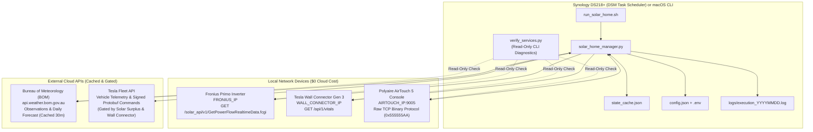

# SolarHomeManager — Architecture & System Design

## 1. Overview
**SolarHomeManager** is a unified, low-overhead home energy and climate orchestrator designed to run on a Synology DS218+ NAS (2 GB RAM, DSM 7.x, Python 3.9) alongside latency-sensitive workloads like Plex Media Server.

Instead of running separate automation processes for EV solar charging and HVAC climate control—which would compete for the same solar export readings on the Fronius smart meter and cause power oscillation—**SolarHomeManager** executes as a single periodic script invoked every 2–5 minutes by Synology DSM Task Scheduler. On each run, it gathers a complete snapshot of the home, evaluates a deterministic **4-Tier Priority Waterfall**, dispatches coordinated state transitions, persists state to `state_cache.json`, and exits cleanly (`0 MB` idle RAM between ticks).

---

## 2. System Topology



---

## 3. Mathematical Model: True Discretionary Solar Pool

When the Tesla is charging or the AirTouch 5 is running in solar pre-cooling/pre-heating mode, the Fronius Smart Meter (`P_Grid`) reports the *remaining* net grid power after those loads are already subtracted. To calculate the true total discretionary solar power available on each tick without causing shut-off feedback loops:

1. **Raw Net Export ($P_{\text{export}}$):**
   $$P_{\text{export}} = \begin{cases} P_{\text{grid}} & \text{if } \text{FRONIUS\_EXPORT\_IS\_POSITIVE is True} \\ -P_{\text{grid}} & \text{if } \text{FRONIUS\_EXPORT\_IS\_POSITIVE is False} \end{cases}$$

2. **Active EV Charging Draw ($P_{\text{ev\_draw}}$):**
   $$\text{If } \text{charging is True}: \quad P_{\text{ev\_draw}} = I_{\text{active\_amps}} \times V_{\text{grid}}$$

3. **Active Discretionary HVAC Draw ($P_{\text{hvac\_tier3}}$):**
   - If the AirTouch 5 is actively running in **Tier 3 (`TIER3_PRECOOL` or `TIER3_PREHEAT`)**, its draw (`HVAC_ESTIMATED_WATTS`, default `2000 W`) is *discretionary* and is added back into the pool:
     $$P_{\text{hvac\_tier3}} = \text{HVAC\_ESTIMATED\_WATTS}$$
   - If the AirTouch 5 is running in **Tier 1 (`Immediate Comfort`)** or **`MANUAL_OVERRIDE`**, its draw is treated as **mandatory household base load** ($P_{\text{hvac\_tier3}} = 0\text{ W}$).

4. **Rolling 15-Minute Median Solar Pool ($P_{\text{median}}$):**
   $$P_{\text{adjusted}} = P_{\text{export}} + P_{\text{ev\_draw}} + P_{\text{hvac\_tier3}}$$
   `P_adjusted` is stored in a rolling 15-minute window in `state_cache.json`, and its **median** ($P_{\text{median}}$) is used to filter out brief cloud transients.

---

## 4. The 4-Tier Priority Waterfall

On every execution tick, energy and climate decisions are evaluated in strict top-down priority order:

| Priority | Tier Name | Trigger Conditions | Power & Control Behavior |
| :---: | :--- | :--- | :--- |
| **1** | **Immediate Home Climate Needs** | Occupied zone temperature $\ge \text{COMFORT\_COOL\_TRIGGER\_C}$ (`24.5°C`) or $\le \text{COMFORT\_HEAT\_TRIGGER\_C}$ (`18.5°C`). | • Runs **regardless of solar surplus** (day or night).<br/>• **Differential Night Purge:** If cooling is needed and outdoor temp is $\ge 2.0^\circ\text{C}$ cooler than indoor (and $\ge 15.0^\circ\text{C}$), runs AirTouch 5 in low-draw `FAN` (`HIGH`) mode.<br/>• **Same-Tick Solar Deduction:** If turning the compressor `OFF -> ON`, immediately deducts `2000 W` from $P_{\text{median}}$ so EV charging steps down in the same tick before the compressor ramps up. |
| **2** | **EV Charging Below 90% SoC** | Vehicle connected to Wall Connector at home during daylight and `battery_level < 90%`. | • Receives **first claim** on discretionary solar pool ($P_{\text{after\_tier1}}$).<br/>• Scales dynamically from `5 A` (`1200 W`) to `32 A` (`7680 W`).<br/>• Preempts Tier 3 thermal banking if residual solar after EV $<90\%$ allocation is below `2000 W`. |
| **3** | **Home Solar Pre-Cool / Pre-Heat** | Daylight banking window (`10:00` to `sunset - 1h`), Tier 1 satisfied, remaining solar $\ge 2000\text{ W}$ (`1500 W` hysteresis once active), and BOM forecast max $\ge 30.0^\circ\text{C}$ (Pre-Cool to `21.0°C`) or $\le 16.0^\circ\text{C}$ / min $\le 8.0^\circ\text{C}$ (Pre-Heat to `22.5°C`). | • Claims `2000 W` of excess solar **before** Tier 4 (`EV 90–100%`) is evaluated.<br/>• Opens priority living/master zones to bank thermal mass in the home ahead of peak afternoon heat or overnight cold. |
| **4** | **EV Top-Off Charging (90–100% SoC)** | Vehicle connected at home during daylight, `90% <= battery_level < charge_limit_soc`, and residual solar after Tier 3 $\ge 1350\text{ W}$ (`1200 W + 150 W buffer`). | • Allocates any remaining excess solar (`5 A..32 A`) to top off the vehicle from `90%` to `100%`. |

### Coordinated Load-Shed Ordering
Whenever power is handed off between the EV and the HVAC in Stage 4 (for example, reducing EV amps to start the AC compressor), **the load reduction command is always dispatched first** and the load increase second, preventing transient grid import spikes.

---

## 5. Temperature Ranges, Target Setpoints & Dynamic Occupancy Model

Because an air conditioner cannot maintain a single exact degree without short-cycling the compressor every few minutes, **SolarHomeManager** uses **time-of-day comfort bands (Daytime vs. Nighttime)** combined with a **Solar Thermal Banking band (Tier 3)**:

1. **Daytime Comfort Band (`07:00 – 22:00` — `18.0°C` to `24.0°C`):**
   - As long as active rooms sit between **`18.0°C` and `24.0°C`**, the house is comfortable and the AC stays **OFF**.
   - **Too Warm ($\ge 24.0^\circ\text{C}$):** Tier 1 Cooling turns ON and cools active rooms down to **`22.0°C`** (`DAY_COOL_TARGET_C`), then turns OFF.
   - **Too Cool ($\le 18.0^\circ\text{C}$):** Tier 1 Heating turns ON and warms active rooms up to **`20.0°C`** (`DAY_HEAT_TARGET_C`), then turns OFF.

2. **Nighttime Comfort Band (`22:00 – 07:00` — `16.0°C` to `23.0°C`):**
   - At night, a cooler sleeping environment is preferred (**`16.0°C` to `23.0°C`**).
   - **Too Warm ($\ge 23.0^\circ\text{C}$):** Tier 1 Cooling (or Differential Night Purge if outdoor air is $\ge 2.0^\circ\text{C}$ cooler than indoor) turns ON and cools active bedrooms down to **`21.0°C`** (`NIGHT_COOL_TARGET_C`), then turns OFF.
   - **Too Cool ($\le 16.0^\circ\text{C}$):** Tier 1 Heating turns ON and warms active bedrooms up to **`18.0°C`** (`NIGHT_HEAT_TARGET_C`), then turns OFF.

3. **Solar Thermal Banking Band (Tier 3 — Free Excess Solar Only, `10:00` to `sunset - 1h`):**
   - When there is $\ge 2000\text{ W}$ of free excess solar (after charging the EV to 90%) and the BOM forecast predicts a hot day ($\ge 30.0^\circ\text{C}$) or cold day ($\le 16.0^\circ\text{C}$ / overnight $\le 8.0^\circ\text{C}$), the system proactively shifts the indoor temperature using free solar (`21.0°C` Pre-Cool in summer, `22.0°C` Pre-Heat in winter) so the house coasts through the evening without needing grid power.

### 5.1 Visual Thermometer & Hysteresis Diagram

```text
  DAYTIME (07:00–22:00)          NIGHTTIME (22:00–07:00)         SYSTEM ACTION
  =====================          =======================         ================================================
       >= 24.0°C                      >= 23.0°C            --->  [TIER 1: IMMEDIATE COOLING TRIGGER]
          |                              |                       • Cools active rooms to 22.0°C (Day) / 21.0°C (Night)
          |                              |                       • Uses FAN Night Purge if outdoor is >= 2°C cooler
     22.0°C–23.9°C                  21.0°C–22.9°C                [UPPER PASSIVE COMFORT DEADBAND]
          |                              |                       • Normal days: AC stays OFF
          |                              |                       • Hot Forecast (>=30°C) + Solar (>=2000W):
          |                              |                         [TIER 3: SOLAR PRE-COOL] cools down to 21.0°C
     20.0°C–22.0°C                  18.0°C–21.0°C                [NEUTRAL COMFORT CORE]
          |                              |                       • Cold Forecast (<=16°C / min <=8°C) + Solar (>=2000W):
          |                              |                         [TIER 3: SOLAR PRE-HEAT] warms up to 22.0°C
     18.1°C–19.9°C                  16.1°C–17.9°C                [LOWER PASSIVE COMFORT DEADBAND]
          |                              |                       • Normal days: AC stays OFF
       <= 18.0°C                      <= 16.0°C            --->  [TIER 1: IMMEDIATE HEATING TRIGGER]
                                                                 • Heats active rooms to 20.0°C (Day) / 18.0°C (Night)
```

### 5.2 Summary of Temperature Parameters (`config.json`)

| Parameter | Default | Role in Decision Engine |
| :--- | :---: | :--- |
| `DAYTIME_HOURS` | `[7, 22]` | Daytime window (`07:00` to `22:00`). Outside this window uses Nighttime thresholds. |
| `DAY_COMFORT_MIN_C` / `MAX_C` | `18.0°C` / `24.0°C` | Daytime acceptable comfort range before Tier 1 Heating or Cooling triggers. |
| `DAY_COOL_TARGET_C` / `HEAT_TARGET_C` | `22.0°C` / `20.0°C` | Daytime target temperature once Tier 1 Cooling or Heating activates. |
| `NIGHT_COMFORT_MIN_C` / `MAX_C` | `16.0°C` / `23.0°C` | Nighttime acceptable comfort range (`22:00–07:00`). |
| `NIGHT_COOL_TARGET_C` / `HEAT_TARGET_C` | `21.0°C` / `18.0°C` | Nighttime target temperature once Tier 1 Cooling or Heating activates. |
| `UNOCCUPIED_COOL_SETBACK_C` | `+1.5°C` | Setpoint relaxation added to scheduled-unoccupied rooms during cooling (`+1.5°C`). |
| `UNOCCUPIED_HEAT_SETBACK_C` | `-1.5°C` | Setpoint relaxation applied to scheduled-unoccupied rooms during heating (`-1.5°C`). |
| `PRECOOL_FORECAST_MAX_C` / `TARGET_C` | `30.0°C` / `21.0°C` | BOM forecast high gate and target temperature for Tier 3 Solar Pre-Cooling. |
| `PREHEAT_FORECAST_MAX_C` / `MIN_C` / `TARGET_C` | `16.0°C` / `8.0°C` / `22.0°C` | BOM forecast gates and target temperature for Tier 3 Solar Pre-Heating. |

---

### 5.3 How Dynamic Occupancy Works in Real Life (Weekends, Sick Days, Holidays)

Household schedules vary from day to day (weekends, public holidays, working from home, or someone staying in bed sick). To make sure the automation **never turns off a room someone just turned on**:

1. **Per-Zone Manual Override Detection (`detect_manual_airtouch_override`):**
   - `state_cache.json` tracks the last dispatched `power` and `setpoint_c` of **every individual zone (`0..4`)** as well as the master AC unit.
   - If someone turns their room `ON` (or adjusts its temperature setpoint) on the wall tablet or AirTouch phone app, **SolarHomeManager** immediately detects the zone change on the next tick and locks out automated HVAC overrides for `HVAC_MANUAL_OVERRIDE_MINUTES` (`120 minutes`). It will **never** turn their room back off 5 minutes later.
2. **Non-Destructive Temperature Setback Instead of Forced Zone Shutoff:**
   - Because all 5 of your zones (e.g. Bedroom 1, Living, Bedroom 2, Bedroom 3, Study — named in `.env` via `ZONE_0_NAME`…`ZONE_4_NAME`) have paired **ITC room temperature sensors** and operate in AirTouch 5's `"TEMPERATURE"` mode, the AirTouch 5 **automatically closes a room's damper to `0%`** whenever that room doesn't need heating or cooling.
   - Instead of rudely forcing a bedroom's power to `OFF` during weekday daytime hours, **SolarHomeManager** leaves `ON` zones `ON` in `"TEMPERATURE"` mode and applies a gentle **`1.5°C` unoccupied setback** (e.g., `23.5°C` instead of `22.0°C` when cooling).
   - If the bedroom is empty and sitting at `22.5°C`, AirTouch 5 keeps its damper at `0%` automatically (wasting zero airflow). If someone is home sick in that bedroom, the room stays `ON` and comfortable—and if they tap the app or wall tablet to set their room to `21.5°C`, the manual override detector immediately respects their setting.
3. **Weekday vs. Weekend Schedules (`occupied_hours` vs. `weekend_occupied_hours`):**
   - Each zone in `config.json` defines both weekday `occupied_hours` and `weekend_occupied_hours` (Saturday/Sunday), and any zone that is currently switched `ON` is monitored against the active `18–24°C` (day) / `16–23°C` (night) comfort band.

### 5.4 Optional Network Presence Hint (No Sensors, No On-Device Software)

Because the household uses a mix of Mac, Windows, and Chromebooks (including a managed company Mac), installing activity agents is off the table and ping alone is unreliable (sleep states, firewalls, and background traffic cause both false present and false absent). The supported middle ground is a **read-only network presence probe** — no packet sniffing, no device software:

- **Sources (LAN-only, polled like Fronius/TWC):** Deco main-node client list (best-effort) + local neighbour table + single ICMP echo per known laptop IP.
- **BE65 status (Oct 2026):** the BE65 serves its client list through an AES-encrypted private web API — no documented local endpoint, and the older LuCI login shapes return 403/404. The Deco login is therefore treated as **blocked for now** (the Deco app remains the human-readable client list); the probe runs on **ping + DHCP reservations**, which need no Deco login.
- **Semantics are deliberately conservative:** network evidence may only ever suggest **VACANT** (device missing from all sources for longer than `PRESENCE_VACANT_AFTER_MINS`, default `45 mins`, across repeated snapshots), which permits a deep setback — it must **never** trigger heating/cooling, and manual tablet control always wins.
- **Setup:** DHCP reservations + disable Private/Randomized Wi-Fi MAC for the home SSID on each laptop; map them in `.env -> PRESENCE_TARGETS_JSON` (`label`, `zone`, `macs`, `ips`); `DECO_MAIN_IP` in `.env` only selects the sweep subnet — the Deco app remains the client list.
- **Measurement before trust:** `python3 verify_services.py presence_net --log presence_log.jsonl` (e.g. every 5 min via cron for 24–48h), then `python3 verify_services.py presence_net --summarize presence_log.jsonl`. If a laptop that was definitely home shows `present_fraction < 0.5`, lengthen the vacancy timeout or accept schedule + ITC as ground truth for that zone.

---

## 6. AirTouch 5 Binary TCP Protocol (`AIRTOUCH_IP:9005`)

- **Magic Header:** `0x55 0x55 0x55 0xAA` (4 bytes)
- **Addressing:**
  - `0x80 0xB0` (Client $\rightarrow$ Console) / `0xB0 0x80` (Console $\rightarrow$ Client) for `0xC0` Control/Status messages:
    - Subtype `0x20`: Zone Control (4 bytes/zone)
    - Subtype `0x21`: Zone Status (8 bytes/zone: Power, Control Mode, Damper %, Setpoint °C, ITC Sensor Temp °C, Low Battery & Spill flags)
    - Subtype `0x22`: AC Control (4 bytes/unit: Power, Mode, Fan Speed, Setpoint °C)
    - Subtype `0x23`: AC Status (10 bytes/unit: Power, Mode, Fan Speed, Setpoint °C, Return Air Temp °C, Spill/Bypass/Turbo flags, Error Code)
  - `0x90 0xB0` / `0xB0 0x90` for `0x1F` Extended messages:
    - Subtype `0xFF 0x13`: Zone Names query/response
- **Byte Stuffing (`0x55 0x55 0x55 0x00`):** Any sequence of three consecutive `0x55` bytes after the 4-byte magic header has `0x00` inserted on transmit and stripped before length/CRC validation on receive.
- **Checksum:** Big-Endian `CRC-16/MODBUS` (`poly=0xA001`, `init=0xFFFF`) computed over unstuffed bytes from Address (`offset 4`) through end of payload.

---

## 7. Hardware & Operational Safety Guards

1. **Manual Tablet / App Override Preemption:**
   - Before evaluating automated HVAC rules, `detect_manual_airtouch_override()` compares live AirTouch 5 status against `cache["airtouch_last_dispatched"]`.
   - If a human changed AC Power, Mode, or Setpoint on the wall tablet or smartphone app, automation locks out for `HVAC_MANUAL_OVERRIDE_MINUTES` (`120 minutes`).
   - If the user manually turns the AC `OFF` during Tier 3 Solar Pre-Cooling/Pre-Heating, solar banking is cancelled for the remainder of that calendar day.
   - During a manual override, EV solar charging continues operating normally around the manual AC load.
2. **Compressor Short-Cycle Protection:**
   - Enforces `HVAC_MIN_ON_MINUTES` (`15 minutes`) before turning the compressor `ON -> OFF` and `HVAC_MIN_OFF_MINUTES` (`6 minutes`) before turning `OFF -> ON`.
3. **Tesla API Quota & Wake Protection:**
   - **Zero-Surplus Inaction:** If not charging and solar surplus $< 1200\text{ W}$, zero Tesla Cloud API calls are made.
   - **Wall Connector Local Gatekeeping:** Queries `http://WALL_CONNECTOR_IP/api/1/vitals` over LAN first; if `vehicle_connected == False`, zero Tesla Cloud API calls are made.
   - **Command & Wake Throttling:** Enforces a `10-minute` interval between EV current adjustments and a `60-minute` wake cooldown.

---

## 8. CLI Diagnostic Tools on macOS / Linux

You can test connectivity and inspect live data from each service from your Mac terminal without modifying any device state:

```bash
# Test core services (Fronius Inverter, Tesla Wall Connector, AirTouch 5, and BOM Weather)
python3 verify_services.py

# Test individual services
python3 verify_services.py inverter
python3 verify_services.py charger
python3 verify_services.py airtouch5
python3 verify_services.py bom

# Network presence probe for known laptops (opt-in, not in `all`)
python3 verify_services.py presence_net
python3 verify_services.py presence_net --log presence_log.jsonl
python3 verify_services.py presence_net --summarize presence_log.jsonl

# Output raw JSON for scripting
python3 verify_services.py --json

# Or invoke via the main orchestrator entrypoint
python3 solar_home_manager.py --check all
```
